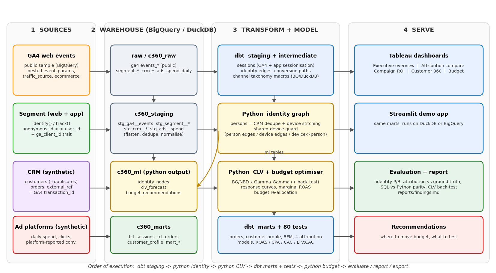

# Customer 360 & Marketing Attribution Platform

One customer view across **website (GA4)**, **mobile app (Segment)**, **CRM** and **ad platforms** - and a straight answer to
*"which marketing channels actually bring revenue, and where should the next dollar go?"*

**Stack:** BigQuery - dbt - Python - Tableau - GA4 - Segment (plus DuckDB so everything also runs locally for free).



## 1. What it does

1. **Ingests** the public GA4 e-commerce sample (BigQuery) + synthetic CRM, Segment and ad-spend tables.
2. **Resolves identities**: devices (GA4 `user_pseudo_id`, Segment `anonymous_id`) <-> logged-in users <-> CRM customers, including CRM duplicates and shared devices.
3. **Models** sessions (web + app), orders (reconciled against CRM) and a customer profile in dbt, with 80 data tests + 3 unit tests.
4. **Scores customers**: RFM, BG/NBD x Gamma-Gamma lifetime value, CLV tiers, lifecycle stages.
5. **Attributes revenue** with first-touch, last-touch, linear and time-decay models and compares them.
6. **Computes** ROAS, ROI, CPA, CAC and LTV:CAC per campaign and channel - next to what the ad platforms claim.
7. **Recommends budget moves** (response curves + model-risk guard) and serves everything to **Tableau** and a Streamlit demo.

## 2. Headline results (demo run - synthetic data, so the *method* transfers, not the absolute numbers)

| Area | Result |
|---|---|
| Pipeline | **about a minute** end to end on 1 CPU (37-71 s in repeated runs; 265 k GA4 events, 62 k sessions, 2.2 k orders); 25 dbt models |
| Quality gates | **80 dbt data tests + 3 dbt unit tests + 33 pytest tests** green; BigQuery SQL syntax-validated offline |
| Reconciliation | 95.9 % of online CRM orders found in tracking, 97.4 % with exactly equal revenue, 25 double-fired purchase events removed |
| Identity resolution | pairwise precision 0.973 / recall 0.952 (F1 0.962); all 76 CRM duplicate people merged; **2 wrong merges vs 53** for naive connected components; 51 of 53 shared devices detected |
| Attribution accuracy (vs simulated truth) | channel-credit error: linear 0.053, time-decay 0.060, last-touch 0.118, first-touch 0.129 (uniform guess 0.358). Campaign-ROAS ranking correlation: linear 0.87, first 0.74, time-decay 0.72, **last-touch 0.29** |
| CLV back-test (92-day holdout) | predicted 417 vs actual 452 repeat orders (-7.7 %); per-customer error 11.9 % below a run-rate baseline |
| SQL vs Python parity | independent pandas re-implementation matches the dbt attribution to $0.0005 |
| Business finding | Paid Search gets **28.7 %** of revenue under first touch but **39.9 %** under last touch. Ad platforms claim a median **2.9x** the time-decay ROAS. For 7 of 11 paid campaigns the models disagree by >2x, so the plan says *test before moving money*; the 3 model-robust moves shift 6.1 % of budget for +2.0 % to +2.9 % attributed revenue |

Full numbers: [`docs/06_test_results.md`](docs/06_test_results.md) | narrative: [`reports/findings.md`](reports/findings.md) | raw: [`reports/metrics.json`](reports/metrics.json)

## 3. Quick start (local, ~5 minutes, no cloud account)

```bash
python -m venv .venv && source .venv/bin/activate     # Python 3.10+
pip install -r requirements.txt
make demo            # generate -> dbt -> identity -> CLV -> dbt marts + tests -> budget plan -> evaluate -> report -> CSV extracts
streamlit run app/streamlit_app.py
```

No time to run the pipeline? `app/demo.duckdb` (12 MB, marts only) ships with the repo: `streamlit run app/streamlit_app.py` works straight after `pip install`.

`make help` lists every step; `make test` runs pytest + dbt unit tests; `make docs` serves the dbt lineage graph.

## 4. Run it on BigQuery with the real GA4 sample

```bash
cp .env.example .env && set -a && source .env && set +a      # set GCP_PROJECT, BQ_LOCATION=US
gcloud auth application-default login
./scripts/setup_bigquery.sh        # datasets + service account + sanity query on the public sample
make bq-load                       # synthetic CRM / Segment / ads built around the REAL GA4 users and transaction ids
make bq-demo                       # dbt on BigQuery + python steps, same order as the local pipeline
```
Details, costs and troubleshooting: [`docs/01_implementation_guide.md`](docs/01_implementation_guide.md).

## 5. The seven project steps -> where they live

| Step | Implementation |
|---|---|
| 1 GA4 sample + synthetic CRM / ad spend | `customer360/datagen/` (`simulate.py` local world, `bq_anchor.py` builds around real GA4 users), `make bq-load` |
| 2 Identity resolution | `models/intermediate/int_identity_edges.sql` (evidence) + `customer360/identity.py` (graph + shared-device guard) |
| 3 dbt: sessions, orders, customer profile | `int_ga4__sessions`, `int_segment__sessions`, `fct_sessions`, `fct_orders`, `customer_profile` |
| 4 RFM, CLV, segments | `customer_rfm.sql`, `customer360/clv.py`, `customer_profile.sql` (CLV tier, lifecycle) |
| 5 Attribution (first / last / linear / time-decay) | `int_attribution__paths.sql`, `fct_attribution_credits.sql`, `mart_attribution_*`; pandas twin in `customer360/attribution.py` |
| 6 Campaign ROI and CPA | `mart_campaign_roi.sql`, `mart_channel_roi.sql`, `mart_campaign_daily.sql` |
| 7 Tableau + budget recommendations | [`docs/05_tableau_guide.md`](docs/05_tableau_guide.md), `exports/tableau/*.csv`, `customer360/recommend.py`, `reports/findings.md` |

## 6. Deliverables checklist

| Deliverable | Where |
|---|---|
| Working demo | Streamlit app (`app/`), recording plan in [`docs/07_final_presentation.md`](docs/07_final_presentation.md) |
| GitHub repo, clean commits, README, setup | this repo (git history included), [`docs/01_implementation_guide.md`](docs/01_implementation_guide.md), CI in [`../.github/workflows/da-01.yml`](../.github/workflows/da-01.yml) |
| Architecture diagram + data/API docs | [`docs/diagrams/`](docs/diagrams), [`docs/02_architecture.md`](docs/02_architecture.md), [`docs/03_data_dictionary.md`](docs/03_data_dictionary.md), `segment/tracking_plan.yaml`, dbt docs (`make docs`) |
| Test results + accuracy numbers | [`docs/06_test_results.md`](docs/06_test_results.md), `reports/metrics.json` |
| 10-minute presentation | [`docs/07_final_presentation.md`](docs/07_final_presentation.md) (slide-by-slide script, timings, demo plan, Q&A) |
| Individual reflections | [`docs/08_individual_reflection_template.md`](docs/08_individual_reflection_template.md) |

## 7. Repository layout

```
customer360/            python package: datagen/, identity.py, clv.py, attribution.py, recommend.py, evaluate.py, report.py, pipeline.py ...
dbt_project/            models/{staging,intermediate,marts}, macros/ (BigQuery <-> DuckDB), tests/, seeds/, unit tests, profiles.yml
app/                    Streamlit demo (+ demo.duckdb)
tableau/ + exports/     build guide inputs and CSV extracts for Tableau Public / Desktop
segment/                tracking plan, analytics.js / iOS snippets (replay script: customer360/segment_replay.py)
docs/                   guides, architecture, data dictionary, methodology, test results, presentation, reflection template
reports/                findings.md, metrics.json, figures/  (generated by the pipeline, committed as a reference run)
tests/                  pytest suite     scripts/  GCP setup, BigQuery SQL validation, diagram + dictionary generators
```

## 8. Design decisions worth knowing

* **One dbt project, two warehouses.** Every BigQuery-vs-DuckDB difference (GA4 `UNNEST`, timestamps, regex, hashing, date math) sits behind `adapter.dispatch` macros in `macros/c360_utils.sql`. The local demo therefore exercises the *same* models that run on BigQuery.
* **Identity is Python, evidence is SQL.** Connected components are awkward in SQL; the dbt edge list stays auditable and the Python graph can be unit-tested and compared with a naive baseline.
* **The simulator knows the truth** (who is who, which touch really mattered), which is what makes accuracy numbers possible. Costs follow a diminishing-returns curve so response-curve fitting can be validated too.
* **Attribution is not incrementality.** Campaigns where models disagree by more than 2x are capped at +/-10 % and flagged *Test incrementality* instead of being optimised on a single model's bias.

## 9. What has - and has not - been verified

* Verified: the whole pipeline on DuckDB (`make demo`), all tests above, determinism (re-running gives identical metrics), every compiled model/test parsed with the BigQuery dialect (`make bq-validate`), the BigQuery loader logic against a stand-in anchor (`tests/test_datagen.py`), every Streamlit page (`tests/test_streamlit_app.py`).
* **Not executed in the build environment** (no credentials / licences): queries against live BigQuery, sending events to a live Segment workspace, and the Tableau workbook (build guide + extracts provided). Expect to fix small environment-specific issues on first BigQuery run - the guide lists the likely ones.

## 10. Limitations and next steps

CRM / Segment / ads are synthetic. Attribution is observational. Paths are left-censored at the start of the window. Next: replace synthetic sources with real loads, run geo-holdout tests for the flagged campaigns, add data-driven (Markov / Shapley) attribution, a small media-mix model as a cross-check, incremental dbt models for the full GA4 export, orchestration (Dagster / Airflow / dbt Cloud) and consent-aware identity.
