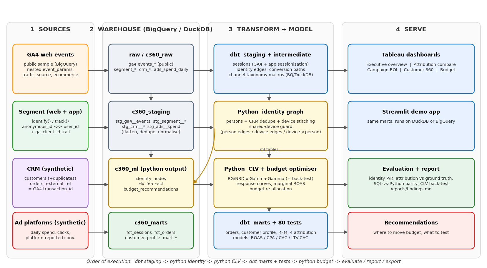
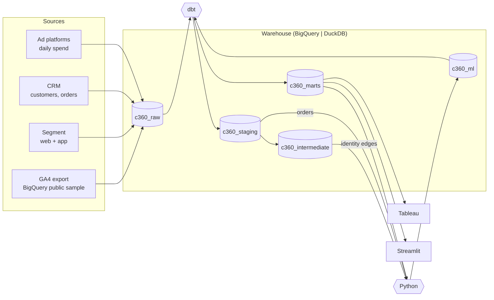
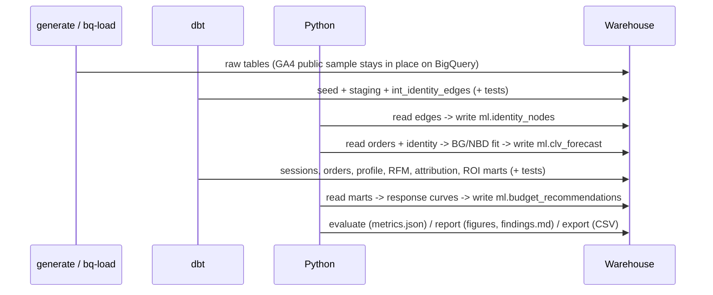
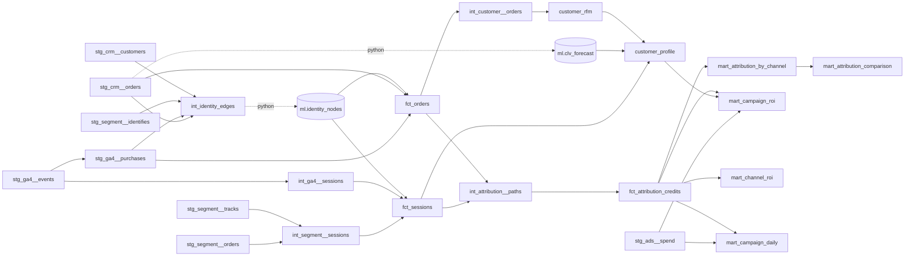
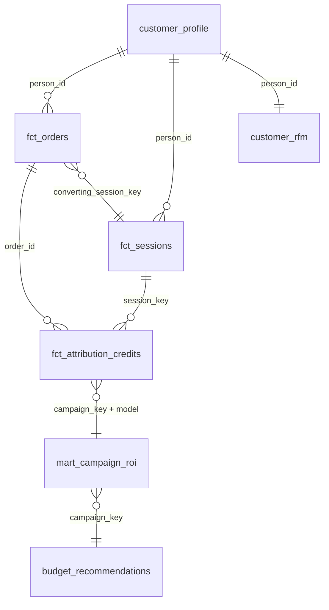

# Architecture



([SVG version](diagrams/architecture.svg))

## 1. System context



## 2. Execution order (why Python sits in the middle of dbt)



`identity_nodes` and `clv_forecast` are declared as dbt **sources** (`ml.*`), so `dbt` and `python` hand tables to each other through the warehouse, with no shared state.
The split is expressed with dbt graph selectors: stage 1 = `+int_identity_edges`, stage 2 = `--exclude +int_identity_edges` (`customer360/pipeline.py`, `make dbt-stage1 / dbt-stage2`).

## 3. Layers and naming

| Layer | Schema / dataset | Materialisation | Content |
|---|---|---|---|
| raw | `c360_raw` (+ public GA4) | tables | exactly as delivered: `ga4_events`, `segment_*`, `crm_*`, `ads_spend_daily` |
| staging | `c360_staging` | views (GA4 events: table) | 1:1 with a source; rename, cast, flatten `event_params`, de-duplicate purchases, normalise e-mail / phone, map UTM -> channel |
| intermediate | `c360_intermediate` | tables | sessions (GA4 + Segment sessionisation), identity edges, conversion paths, person order summary |
| marts | `c360_marts` | tables (`fct_sessions` partitioned on BigQuery) | what Tableau / Streamlit read |
| ml | `c360_ml` | tables written by Python | identity graph, CLV forecast, budget plan, response curves |
| truth | `c360_truth` | local demo only | simulator ground truth, used **only** by `evaluate` |

## 4. The identity graph

```mermaid
flowchart LR
  subgraph Person["person edges (always merge)"]
    C1[crm:C1] --- E[email:ann@x.com]
    C2[crm:C2 duplicate record] --- E
    C2 --- PH[phone:5551234567]
  end
  subgraph Device["device edges (same browser)"]
    SA[sa:ajs-uuid] --- GA[ga:1234.5678]
  end
  SA -. "identify() user_id" .-> C1
  GA -. "order match: GA4 transaction_id = CRM external_ref" .-> C1
  SH[ga:shared-laptop] -. order .-> C1
  SH -. order .-> C9[crm:C9 other person]
```

* **Solid** = strong evidence, merged unconditionally (this also de-duplicates the CRM).
* **Dotted** device->person evidence joins a device to a person **only if the device points to exactly one person**.
  `ga:shared-laptop` points to two people, so it is flagged `is_shared_device` and given to the best-evidenced person; the two people are **not** merged.
* Retroactive stitching: once a device is linked, *all* its sessions (including those before login) belong to the person.

## 5. dbt lineage (simplified)


Run `make docs` for the full interactive graph (25 models, 9 sources, 2 exposures).

## 6. Mart relationships



## 7. Design decisions

| Decision | Alternatives | Why |
|---|---|---|
| **Same dbt project on BigQuery and DuckDB** via `adapter.dispatch` macros | BigQuery-only SQL | zero-cost local demo + CI that exercises the real models; BigQuery syntax additionally validated offline with sqlglot |
| **Python for the graph, SQL for the evidence** | recursive CTE label propagation | connected components + guard logic are testable and benchmarkable in Python; edge list stays auditable in SQL |
| **CRM is the revenue system of record** | GA4 `purchase_revenue` | tracking loses orders (consent, blockers) and double-fires; CRM has returns/refunds. GA4/Segment supply *sessions*, CRM supplies *orders* |
| **Credit is dated by touch, not by order** (for curve fitting) | order date | aligns cost with the revenue it produced |
| **Every order always gets 100 % credit** (`Unattributed` pseudo-channel) | drop untracked orders | totals reconcile to revenue; coverage is visible (95 % attributed here) |
| **Direct is deprioritised** | Direct competes | Direct is usually the *return visit*, not the driver; configurable (`direct_policy`) and its effect is measured in `evaluate` |
| **Model-risk guard in the optimiser** | optimise a single model | last-touch and first-touch rank campaigns almost oppositely; moving money on one model's bias is the classic mistake |
| **Simulated ground truth** | only reconcile totals | the only way to produce real *accuracy* numbers for identity, attribution and response curves |

## 8. Warehouse portability (macros/c360_utils.sql)

| Macro | BigQuery | DuckDB |
|---|---|---|
| `c360_ga4_param` | `(select value.x from unnest(event_params) where key=..)` | `list_filter(event_params, lambda p: ...)[1].value.x` |
| `c360_ts_from_micros` | `timestamp_micros` | `make_timestamp` |
| `c360_parse_yyyymmdd` | `parse_date('%Y%m%d', x)` | `strptime(x, '%Y%m%d')::date` |
| `c360_epoch_seconds` | `unix_seconds` | `floor(epoch(ts))` |
| `c360_date_diff_days`, `c360_ts_sub_days` | `date_diff`, `timestamp_sub` | `date_diff('day', ..)`, `ts - interval n day` |
| `c360_regexp_replace_all`, `c360_md5`, `c360_float` | `regexp_replace(r'..')`, `to_hex(md5())`, `float64` | `regexp_replace(.., 'g')`, `md5()`, `double` |
| `c360_normalize_email/phone`, `c360_channel_group`, `c360_campaign_key` | shared SQL built from the above | |

BigQuery-only options (`partition_by`, `cluster_by` on `fct_sessions`, `_table_suffix` pruning of `events_*`) are wrapped in `target.type == 'bigquery'`.

## 9. Interfaces / contracts

* **GA4 export** - fields used: `event_date, event_timestamp, event_name, user_pseudo_id, user_id, event_params[ga_session_id, ga_session_number, page_location, source, medium, campaign, engagement_time_msec], traffic_source.{source,medium,name}, device.{category,operating_system}, geo.{country,city}, ecommerce.{transaction_id, purchase_revenue_in_usd, total_item_quantity}`.
* **Segment** - `identifies`, `tracks`, `order_completed` with the traits/properties in [`segment/tracking_plan.yaml`](../segment/tracking_plan.yaml). `order_id` must equal the CRM `external_ref` and the GA4 `transaction_id`.
* **CRM** - `customers(customer_id, names, email, phone, country, city, created_at, ...)`, `orders(order_id, customer_id, ordered_at, order_channel, status, order_total, discount_amount, refund_amount, external_ref)`.
* **Ads** - `date, platform, campaign_id, campaign_name, utm_source, utm_medium, utm_campaign, impressions, clicks, cost, platform_conversions, platform_conversion_value`. `utm_*` must match the UTMs on the site.
* **Outputs** - the marts in [03_data_dictionary.md](03_data_dictionary.md); CSV extracts in `exports/tableau/`.

## 10. Privacy, security, cost

* No raw e-mail or phone leaves staging: marts carry `email_hash` (md5 of the normalised e-mail) and no phone; the CSV extract for Tableau drops names and hashes.
* GA4 consent denial is modelled (6 % of customers are invisible to web tracking) and shows up as `Unattributed` revenue rather than being guessed.
* Secrets only via environment variables / ADC; `.gitignore` excludes keys and `.env`.
* BigQuery: partitioned + clustered session fact, date-pruned wildcard reads, small intermediate tables; set `maximum_bytes_billed` in the profile for production.

## 11. Scaling notes

For the full GA4 export: incremental `stg_ga4__events` (partition by `event_date`, 3-day lookback for late events), incremental `fct_sessions`, schedule the six steps with Dagster/Airflow/dbt Cloud (dbt stage 1 -> Python identity -> Python CLV -> dbt stage 2), and move the Python steps to Cloud Run jobs / Vertex pipelines.
The identity step is O(edges) with a union-find, i.e. seconds for millions of edges; BG/NBD fitting is O(customers) per optimiser iteration.
