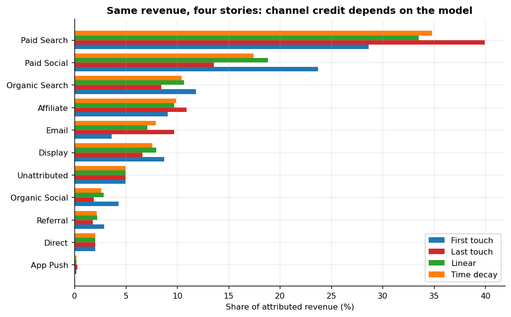
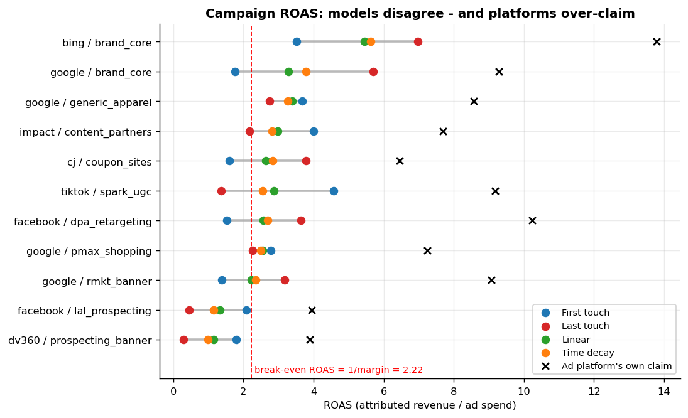
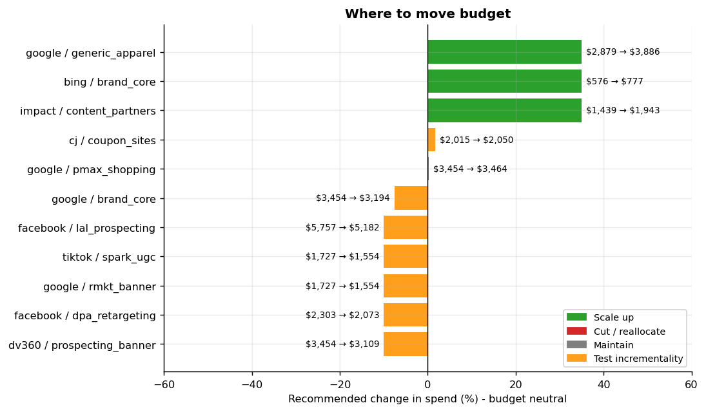
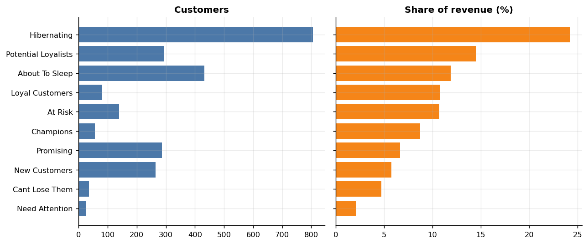
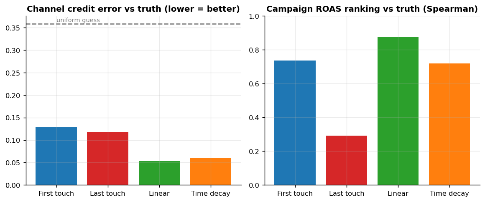

# Findings and budget recommendations

_Auto-generated by `python -m customer360 report` from run data (target: **duckdb**). Window 2020-11-01 to 2021-01-31._

## 1. Headlines

- **2,050 completed orders, $98,724 net revenue; $28,787 ad spend -> blended ROAS (MER) 3.43x**, blended CAC $23 per new customer (1,248 new customers).
- **The attribution model changes the answer.** Paid Search receives 28.7% of revenue under first touch, 39.9% under last touch, 33.5% linear and 34.8% time-decay (a 11.3 percentage-point swing).
- **Ad platforms over-claim.** Platform-reported ROAS is a median 2.9x the time-decay ROAS.
- **Budget:** moving $1,758 (6.1% of the $28,787 paid budget) is projected to change attributed revenue by +2.5% on average across models (worst model +2.0%). 7 of 11 campaigns are flagged **Test incrementality**: the models disagree about them too much for attribution alone to decide.

## 2. Attribution models side by side (share of attributed revenue)

| Channel | First touch | Last touch | Linear | Time decay | Swing (pp) |
|---|---|---|---|---|---|
| Paid Search | 28.7% | 39.9% | 33.5% | 34.8% | 11.3 |
| Paid Social | 23.7% | 13.5% | 18.8% | 17.4% | 10.2 |
| Organic Search | 11.8% | 8.4% | 10.7% | 10.4% | 3.4 |
| Affiliate | 9.1% | 10.9% | 9.7% | 9.9% | 1.8 |
| Email | 3.6% | 9.7% | 7.1% | 7.9% | 6.1 |
| Display | 8.7% | 6.6% | 8.0% | 7.6% | 2.1 |
| Unattributed | 5.0% | 5.0% | 5.0% | 5.0% | 0.0 |
| Organic Social | 4.3% | 1.9% | 2.8% | 2.6% | 2.4 |
| Referral | 2.9% | 1.8% | 2.2% | 2.1% | 1.1 |
| Direct | 2.0% | 2.0% | 2.0% | 2.0% | 0.0 |
| App Push | 0.2% | 0.3% | 0.2% | 0.2% | 0.1 |

## 3. Campaign ROI

| Campaign | Spend | ROAS FT / LT / Lin / TD | Platform ROAS | CPA (TD) | CAC (TD) | LTV:CAC (TD) |
|---|---|---|---|---|---|---|
| facebook / lal_prospecting | $5,757 | 2.08 / 0.45 / 1.34 / 1.15 | 3.95 | $39 | $62 | 1.17 |
| dv360 / prospecting_banner | $3,454 | 1.80 / 0.29 / 1.16 / 0.99 | 3.9 | $51 | $73 | 0.96 |
| google / pmax_shopping | $3,454 | 2.78 / 2.26 / 2.55 / 2.50 | 7.25 | $19 | $31 | 2.4 |
| google / brand_core | $3,454 | 1.75 / 5.70 / 3.29 / 3.79 | 9.28 | $13 | $21 | 3.41 |
| google / generic_apparel | $2,879 | 3.68 / 2.74 / 3.40 / 3.28 | 8.57 | $16 | $24 | 3.09 |
| facebook / dpa_retargeting | $2,303 | 1.53 / 3.65 / 2.57 / 2.70 | 10.25 | $19 | $30 | 2.41 |
| cj / coupon_sites | $2,015 | 1.60 / 3.79 / 2.64 / 2.83 | 6.46 | $17 | $25 | 2.86 |
| google / rmkt_banner | $1,727 | 1.39 / 3.19 / 2.23 / 2.35 | 9.08 | $19 | $34 | 2.1 |
| tiktok / spark_ugc | $1,727 | 4.57 / 1.37 / 2.88 / 2.55 | 9.18 | $19 | $29 | 2.56 |
| impact / content_partners | $1,439 | 4.00 / 2.18 / 2.97 / 2.83 | 7.7 | $17 | $26 | 2.87 |
| bing / brand_core | $576 | 3.52 / 6.97 / 5.46 / 5.63 | 13.79 | $9 | $14 | 5.18 |

Break-even ROAS on gross profit is 1 / 0.45 = **2.22**; anything below it loses money before overheads.

## 4. Where to move budget

| Campaign | Action | Current | Recommended | Change | Median ROAS | Confidence |
|---|---|---|---|---|---|---|
| bing / brand_core | Scale up | $576 | $777 | 35.0% | 5.54 | Medium |
| impact / content_partners | Scale up | $1,439 | $1,943 | 35.0% | 2.9 | Medium |
| google / generic_apparel | Scale up | $2,879 | $3,886 | 35.0% | 3.34 | High |
| cj / coupon_sites | Test incrementality | $2,015 | $2,050 | 1.7% | 2.73 | Low (models disagree) |
| google / pmax_shopping | Maintain | $3,454 | $3,464 | 0.3% | 2.52 | High |
| google / brand_core | Test incrementality | $3,454 | $3,194 | -7.5% | 3.54 | Low (models disagree) |
| tiktok / spark_ugc | Test incrementality | $1,727 | $1,554 | -10.0% | 2.71 | Low (models disagree) |
| facebook / lal_prospecting | Test incrementality | $5,757 | $5,182 | -10.0% | 1.24 | Low (models disagree) |
| facebook / dpa_retargeting | Test incrementality | $2,303 | $2,073 | -10.0% | 2.63 | Low (models disagree) |
| google / rmkt_banner | Test incrementality | $1,727 | $1,554 | -10.0% | 2.29 | Low (models disagree) |
| dv360 / prospecting_banner | Test incrementality | $3,454 | $3,109 | -10.0% | 1.07 | Low (models disagree) |

**Why campaigns are flagged**

- `cj / coupon_sites` (last/first-touch ROAS ratio 2.37): Closer: last-touch ROAS is >2x first-touch. Likely harvests demand created elsewhere - validate with a holdout before scaling.
- `google / brand_core` (last/first-touch ROAS ratio 3.25): Closer: last-touch ROAS is >2x first-touch. Likely harvests demand created elsewhere - validate with a holdout before scaling.
- `tiktok / spark_ugc` (last/first-touch ROAS ratio 0.30): Introducer: last-touch undervalues it (first-touch ROAS >2x). Don't cut on last-click alone - validate with a geo/holdout test.
- `facebook / lal_prospecting` (last/first-touch ROAS ratio 0.22): Introducer: last-touch undervalues it (first-touch ROAS >2x). Don't cut on last-click alone - validate with a geo/holdout test.
- `facebook / dpa_retargeting` (last/first-touch ROAS ratio 2.39): Closer: last-touch ROAS is >2x first-touch. Likely harvests demand created elsewhere - validate with a holdout before scaling.
- `google / rmkt_banner` (last/first-touch ROAS ratio 2.30): Closer: last-touch ROAS is >2x first-touch. Likely harvests demand created elsewhere - validate with a holdout before scaling.
- `dv360 / prospecting_banner` (last/first-touch ROAS ratio 0.16): Introducer: last-touch undervalues it (first-touch ROAS >2x). Don't cut on last-click alone - validate with a geo/holdout test.

**Method.** Per campaign and per model a power-law response curve (revenue ~ spend^beta, Poisson quasi-likelihood, bootstrap SE, shrunk to a prior) gives marginal ROAS; the same total budget is re-allocated to equalise marginal ROAS while maximising the average over the four models; campaigns where last-touch ROAS is >2x or <0.5x first-touch ROAS are capped at +/-10% and flagged.

**Important:** attribution measures who *gets credit*, not what is *incremental*. Treat "Scale up / Cut" as high-confidence only where all models agree; run holdout or geo-lift tests for the flagged campaigns before large moves.

## 5. Customer segments

| RFM segment | Customers | % customers | % revenue | Avg revenue | Avg recency (days) |
|---|---|---|---|---|---|
| Hibernating | 806 | 33.2 | 24.2 | $64 | 227 |
| Potential Loyalists | 295 | 12.2 | 14.5 | $104 | 22 |
| About To Sleep | 433 | 17.8 | 11.9 | $58 | 63 |
| Loyal Customers | 82 | 3.4 | 10.8 | $279 | 47 |
| At Risk | 140 | 5.8 | 10.7 | $163 | 188 |
| Champions | 57 | 2.3 | 8.7 | $326 | 11 |
| Promising | 287 | 11.8 | 6.7 | $49 | 36 |
| New Customers | 264 | 10.9 | 5.8 | $46 | 11 |
| Cant Lose Them | 36 | 1.5 | 4.7 | $278 | 159 |
| Need Attention | 26 | 1.1 | 2.1 | $169 | 66 |

| Lifecycle stage | Customers | Historical revenue | Forecast 12-mo revenue |
|---|---|---|---|
| Active | 1157 | $115,867 | $90,893 |
| At Risk | 337 | $32,026 | $15,048 |
| Churned | 549 | $45,558 | $13,159 |
| New | 383 | $19,219 | $31,053 |
| Prospect | 872 | $0 | $0 |

- **Win-back priority:** 140 Platinum/Gold customers are At Risk or Churned, with $31,264 historical revenue.
- **CLV model back-test:** forecast 417 vs actual 452 repeat orders in the 92-day holdout (-7.7%), per-customer MAE 12% better than a run-rate baseline.

## 6. Validation against simulated ground truth

The synthetic world knows each touchpoint's true incrementality. Closest to truth at channel level: **Linear** (TVD 0.053; a uniform guess scores 0.358). Last-touch ranks campaign ROAS with Spearman rho = 0.29 vs 0.87 for linear. _These are simulation results - they show the method works and why last-click misleads, not that linear is best on real data._

## 7. Limitations

- CRM, Segment and ad data are synthetic; absolute numbers are illustrative. Only the method and the pipeline transfer to real data.
- Attribution is observational: it cannot separate demand that would have converted anyway (brand search, retargeting, coupon sites).
- Paths are left-censored at the start of the tracking window; consent-denied and unlinked devices are invisible (see identity metrics).
- Revenue is attributed by touch date for curve fitting; the last 14 days are excluded because their orders are not yet observed.
