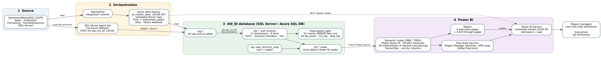

# Enterprise Business Intelligence Suite for a Multi-Region Company

One reporting system that combines **sales, finance, HR and supply-chain** data from Microsoft's AdventureWorks sample, with **secure per-region access**.
Stack: **SQL Server · Azure Data Factory (or SQL Agent) · Power Query · DAX · Power BI** (PBIP/TMDL/PBIR).



## What is in the box

| Brief step | Where | What |
|---|---|---|
| 1. Dataset | `scripts/download_adventureworks.sh` | AdventureWorks2022 OLTP (31,465 orders · 121,317 lines · 290 employees · 104 vendors · 8,845 PO lines) |
| 2. Star schema + Power Query | `tools/model_spec.py`, `sql/03_dw_schema.sql`, `powerbi/power-query/` | 11 dimensions, 6 facts; M queries clean, rename and type every table |
| 3. Data movement | `adf/`, `sql/11_sql_agent_job.sql` | Metadata-driven ADF pipelines (full + watermark upsert) **or** a SQL Agent job when Azure is unavailable |
| 4. DAX | `powerbi/dax/measures.dax` | 58 measures: YTD, YoY, margin %, rolling 3M/12M, quota attainment, semi-additive headcount, supply-chain KPIs |
| 5. Pages | `powerbi/EnterpriseBI.Report/`, `docs/report-spec.md` | 5 executive pages + 3 drill-through pages |
| 6. Row-level security | `powerbi/dax/rls.dax`, `sql/04_security.sql` | Dynamic RLS by user → territory map; `Region Manager` + `Global Executive` roles |
| 7. Publish + refresh + guide | `scripts/publish_powerbi.ps1`, `docs/publish-and-refresh.md`, `docs/user-guide.md` | Service publish, scheduled refresh, one-page user guide (+PDF) |

Deliverables checklist → [docs/deliverables-checklist.md](docs/deliverables-checklist.md).

## Quick start

**Path A - local, no Azure** (SQL Server 2019/2022 or the Docker image)

```bash
# Windows + SQL Server:   pwsh scripts/setup_local.ps1 -Server localhost
# Linux / macOS / WSL:
export SA_PASSWORD='YourStrong!Passw0rd'; ./scripts/download_adventureworks.sh
docker compose up -d && SQLPASSWORD=$SA_PASSWORD ./scripts/setup_local.sh
```
This restores AdventureWorks2022, builds database `AW_BI`, runs the ETL (`etl.usp_run_all`) and then the SQL test suite. Then open `powerbi/EnterpriseBI.pbip` in Power BI Desktop, set parameters `p_SqlServer` / `p_Database`, **Refresh**.

**Path B - Azure**: follow [docs/etl-and-adf.md](docs/etl-and-adf.md) (Key Vault → self-hosted IR → `scripts/deploy_adf.ps1`).

Full walkthrough with expected outputs: **[docs/implementation-guide.md](docs/implementation-guide.md)**.

## Verification status (read this first)

| Layer | What was actually run | Result | Confidence it works first try on your machine |
|---|---|---|---|
| SQL transforms (all dim/fact SELECTs, 52 DQ checks) | Executed on the real AdventureWorks data in DuckDB via sqlglot, cross-checked against an independent pandas implementation (`tests/test_pipeline.py`) | **89 tests pass** | High (~90%) for the *logic*; T-SQL dialect differences are the residual risk |
| T-SQL wrapper code (DDL, procs, orchestration, Agent job) | Parsed with sqlglot's T-SQL grammar (114 batches, 0 errors). **Not executed on SQL Server.** | syntax OK | Medium (~70%): expect 0-3 small fixes |
| Power BI model (TMDL), report (PBIR), theme | All 108 JSON files validated against Microsoft's published JSON schemas; 58 DAX measures + 178 report field references cross-checked against the model. **Never opened in Power BI Desktop.** | schema OK | TMDL ~65%, PBIR ~55% open without a message; fallback = `docs/report-spec.md` |
| DAX measure *values* | Not run (no DAX engine here). Expected values are in `tests/baselines/` and `tests/dax/test_cases.json` | - | Medium (~75%) |
| ADF pipelines | JSON well-formed, all references resolve. **Not deployed.** | - | Medium (~65%) |
| Publish / refresh / RLS in the Service, demo video, reflections | **Not done - they need your tenant and your voice.** | - | - |

`pytest -q tests` (needs `scripts/download_adventureworks.sh` first) re-runs everything that *can* run without SQL Server or Power BI. See [docs/test-plan-and-results.md](docs/test-plan-and-results.md).

## Layout

```
sql/        T-SQL: framework, staging, star schema, ETL procs, DQ gate, rpt views, Agent job   (02,03,06,07,09,10 are generated)
adf/        Azure Data Factory JSON (linked services, datasets, 3 pipelines, trigger)
powerbi/    PBIP: SemanticModel (TMDL) + Report (PBIR) + Power Query + DAX + theme
tools/      model_spec.py (single source of truth) + generators, validators, baselines, DuckDB harness
tests/      pytest (DuckDB + static), SQL Server suites, DAX suite, baselines, results
scripts/    setup, download, deploy, publish, git history
docs/       architecture, data model/dictionary, guides, user guide, presentation, templates
```

Regenerate everything derived from the spec: `python tools/build_repo.py` (CI fails if generated files drift: `--check`).
License: MIT (code). AdventureWorks is Microsoft's MIT-licensed sample database.
