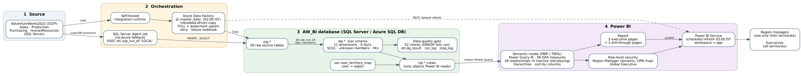
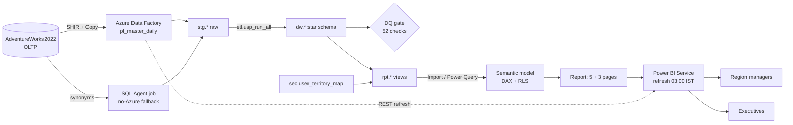

# Architecture

*Mermaid version (renders on GitHub):*

## Layers

| Layer | Objects | Responsibility |
|---|---|---|
| Source | AdventureWorks2022 | Read-only OLTP system. Never modified. |
| Orchestration | ADF `pl_master_daily` → `pl_extract_to_staging` → `pl_transform_and_test`; or SQL Agent job | Move data, retry, alert, trigger the Power BI refresh |
| Staging `stg` | 28 tables, only the columns we need | Raw copy; truncate+load (FULL) or watermark upsert (INCREMENTAL) |
| Warehouse `dw` | 11 dims, 6 facts | Business logic: cost-by-date COGS, allocation of freight/tax, region assignment, month-end snapshots |
| Control `etl` | config, watermark, run_log, step_log, dq_check, dq_result | Metadata-driven pipeline, audit, data-quality gate |
| Serving `rpt` | 17 views + `vw_sec_user_territory` | The only schema Power BI (and the `bi_reader` role) can read |
| Security `sec` | `user_territory_map` | Which user sees which territory |
| Semantic model | TMDL, Power Query M, 58 measures, 2 roles | Metrics definition + row-level security (single source of truth for KPIs) |
| Report | PBIR, 8 pages | Executive KPIs, drill-through detail |

## Key decisions (ADR-style)

1. **Transforms in SQL, not in Power Query.** Power Query is used for *shaping* (rename, trim, type, null handling, friendly names); business logic that must be tested and reused lives in tested SQL. Reason: the same numbers are available to any other consumer, and the logic is unit-testable (it is - in DuckDB, see test plan).
2. **Full rebuild of facts each run, atomically** (`TRUNCATE + INSERT` inside a transaction). Reason: data volume is small (121k lines), rebuild is idempotent and simple. Incremental *extraction* already exists in ADF; incremental *loading* is a documented next step.
3. **Import mode** with Power BI scheduled refresh after the ETL window (ETL 02:00 → refresh 03:00 IST); ADF can also trigger the refresh through the REST API.
4. **One region concept** (sales territory) copied into every fact → one RLS rule, no bi-directional relationships.
5. **Deny by default.** A user in the `Region Manager` role who is not in the mapping table sees nothing (tested: `rls: unmapped user sees 0 territories`).
6. **Data minimisation.** National ID, birth date, gender, logins and pay rates are never extracted.

## Non-functional notes

- **Security:** Key Vault for ADF secrets; `bi_reader` has SELECT on `rpt` only; RLS enforced in the model; share via an app (Viewer), never via workspace Contributor+ (they bypass RLS).
- **Observability:** `etl.run_log`/`step_log` (durations, rows), `etl.dq_result` (every check, every run), ADF Monitor, optional failure webhook, Power BI refresh-failure e-mail.
- **Performance:** all fact tables < 60k rows after load except sales lines (121k): expect refresh in seconds to low minutes. Measure and record in the test plan.
- **Cost (Azure path):** Azure SQL Database free/serverless tier + ADF runs of a few DIU-minutes per night; self-hosted IR is free.
- **DR/backup:** the warehouse is fully rebuildable from source (`sql/` + one `usp_run_all`); back up only `etl.*` and `sec.*`.
