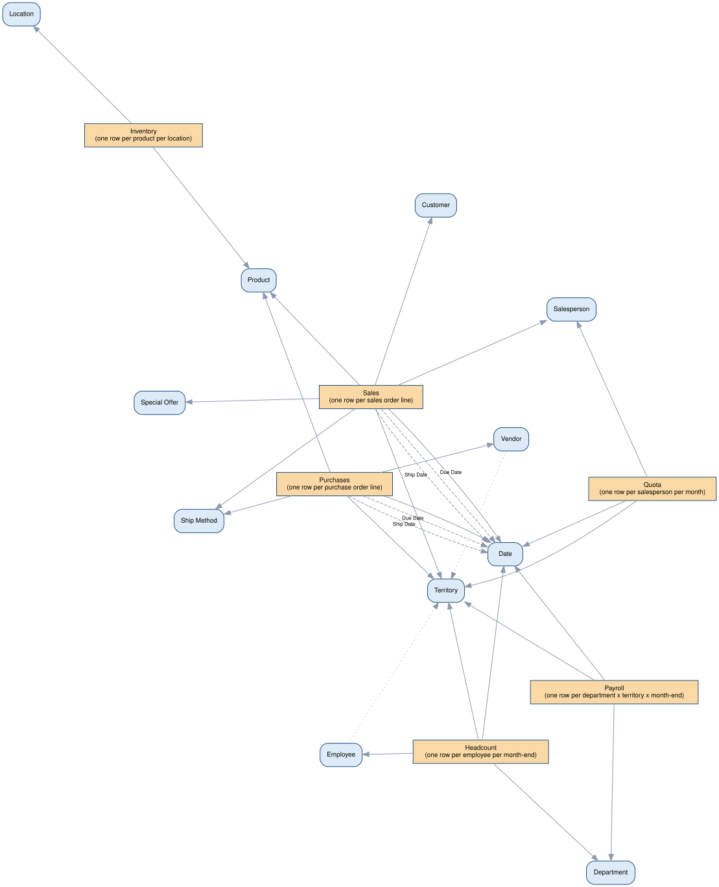

<!-- GENERATED by tools/build_repo.py - do not edit by hand -->
# Data model

A **constellation (galaxy) star schema**: 6 fact tables share 11 conformed dimensions. 28 relationships in the Power BI model (24 active, 4 inactive role-playing date relationships). All relationships are single-direction, many-to-one, dimension → fact; there are no bi-directional filters, which keeps row-level security predictable.

```mermaid
erDiagram
    Sales }o--|| Date : "Order Date"
    Sales }o--|| Date : "Ship Date (inactive)"
    Sales }o--|| Date : "Due Date (inactive)"
    Sales }o--|| Customer : "customer"
    Sales }o--|| Product : "product"
    Sales }o--|| Territory : "territory"
    Sales }o--|| Salesperson : "salesperson"
    Sales }o--|| Special_Offer : "special_offer"
    Sales }o--|| Ship_Method : "ship_method"
    Quota }o--|| Date : "Quota Month"
    Quota }o--|| Salesperson : "salesperson"
    Quota }o--|| Territory : "territory"
    Purchases }o--|| Date : "Order Date"
    Purchases }o--|| Date : "Ship Date (inactive)"
    Purchases }o--|| Date : "Due Date (inactive)"
    Purchases }o--|| Vendor : "vendor"
    Purchases }o--|| Product : "product"
    Purchases }o--|| Ship_Method : "ship_method"
    Purchases }o--|| Territory : "territory"
    Inventory }o--|| Product : "product"
    Inventory }o--|| Location : "location"
    Headcount }o--|| Date : "Month End"
    Headcount }o--|| Employee : "employee"
    Headcount }o--|| Department : "department"
    Headcount }o--|| Territory : "territory"
    Payroll }o--|| Date : "Month End"
    Payroll }o--|| Department : "department"
    Payroll }o--|| Territory : "territory"
```

## Tables and grain

| Table | Power BI name | Grain | Notes |
|---|---|---|---|
| `dw.dim_date` | Date | one row per calendar day | Conformed calendar + fiscal calendar (fiscal year starts July; FY is named by the year it ends). |
| `dw.dim_territory` | Territory | one row per sales territory (+ Unassigned) | Sales territory = the 'region' that row-level security is keyed on. |
| `dw.dim_product` | Product | one row per product | Product with subcategory, category and model (SCD type 1). |
| `dw.dim_customer` | Customer | one row per customer | Customer (individual or reseller store). |
| `dw.dim_salesperson` | Salesperson | one row per salesperson (+ online) | Sales representatives; -1 = online orders (no salesperson). |
| `dw.dim_employee` | Employee | one row per employee | Employees. Data-minimised: no national ID, birth date, gender or pay rate is loaded. |
| `dw.dim_department` | Department | one row per department | HR departments. |
| `dw.dim_vendor` | Vendor | one row per vendor | Suppliers; region = territory of the vendor's main-office address. |
| `dw.dim_special_offer` | Special Offer | one row per special offer | Sales promotions. |
| `dw.dim_ship_method` | Ship Method | one row per ship method | Shipping methods (sales and purchasing). |
| `dw.dim_location` | Location | one row per location | Inventory locations (production areas). |
| `dw.fact_sales_line` | Sales | one row per sales order line | Sales order line (Sales.SalesOrderDetail) with cost and header-level freight/tax allocated by revenue share. |
| `dw.fact_sales_quota` | Quota | one row per salesperson per month | Sales quota per salesperson per month (quarterly quota spread evenly over the quarter's 3 months). |
| `dw.fact_purchase_line` | Purchases | one row per purchase order line | Purchase order line with delivery performance; region = vendor region. |
| `dw.fact_inventory` | Inventory | one row per product per location | Current on-hand inventory snapshot per product and location (AdventureWorks has no inventory history). Company-wide, not regional. |
| `dw.fact_headcount_monthly` | Headcount | one row per employee per month-end | Month-end employee snapshot (department as of month end). No pay data. |
| `dw.fact_payroll_monthly` | Payroll | one row per department x territory x month-end | Estimated payroll cost aggregated to department x region x month (rate x 173.33 h). Aggregated so individual pay is not exposed. |

## Design decisions

- **Surrogate keys** (identity) on every dimension except `dim_date` (yyyymmdd). Each dimension has an **unknown member** (`-1`) so a failed lookup never drops fact rows; a WARN data-quality check reports how often it is used.
- **SCD type 1** everywhere. AdventureWorks carries history only where it matters here: product cost (used at *fact load* via `ProductCostHistory` by order date, so COGS is historically correct) and employee department (captured in the month-end headcount snapshot).
- **Region = sales territory.** Facts that have no native region get one at load time: purchases → vendor main-office territory, employees/payroll → home-address territory. Every fact therefore joins `Territory` directly, so one RLS filter secures all of them.
- **Freight and tax** are header-level amounts; they are allocated to lines by revenue share so line-grain facts still reconcile to `SalesOrderHeader` (tested to ±$1).
- **Privacy by design:** no national ID, birth date, gender, login or pay rate is loaded. Payroll is aggregated to department × territory × month so individual pay cannot be derived from the model.
- **Inventory** has no history in AdventureWorks and no region; it is a company-wide current snapshot (see [assumptions](assumptions-and-limitations.md)).
- **Import mode** (not DirectQuery): fastest visuals, and RLS is evaluated in the model.
