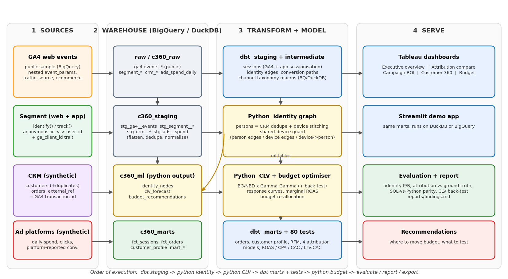
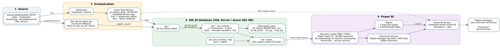

# Data Analytics Internship - Final Project Submission

Two end-to-end analytics projects, each in its own folder with source code, tests, documentation and screenshots.

| Folder | Project | Stack | Start here |
|---|---|---|---|
| [`DA-01/`](DA-01) | **Customer 360 & Marketing Attribution Platform** - one customer view across GA4, Segment, CRM and ad spend; identity resolution, RFM/CLV, four attribution models, campaign ROI, budget recommendations | BigQuery, dbt, Python, DuckDB, Tableau, Streamlit | [`DA-01/README.md`](DA-01/README.md) |
| [`DA-02/`](DA-02) | **Enterprise BI Suite for a Multi-Region Company** - sales, finance, HR and supply-chain star schema on AdventureWorks, metadata-driven ETL, 58 DAX measures, 8-page Power BI report, row-level security per region | SQL Server, Azure Data Factory, Power Query, DAX, Power BI | [`DA-02/README.md`](DA-02/README.md) |

## Architecture

| DA-01 | DA-02 |
|---|---|
|  |  |

## Repository layout

```
.github/workflows/   da-01.yml, da-02.yml  (one CI workflow per project, run from the project folder)
DA-01/               customer360/ (Python), dbt_project/, app/ (Streamlit), segment/, tableau/, exports/, reports/, docs/, tests/, screenshots/
DA-02/               sql/, adf/, powerbi/ (PBIP: TMDL + PBIR), tools/, scripts/, docs/, tests/, screenshots/
```

## Run each project

**DA-01** (local, no cloud account, about 5 minutes; Python 3.10+)
```bash
cd DA-01
python -m venv .venv && source .venv/bin/activate
pip install -r requirements.txt
make demo                          # generate -> dbt -> identity -> CLV -> marts + tests -> budget -> report
streamlit run app/streamlit_app.py # or run it directly on the shipped app/demo.duckdb
python -m pytest -q                # unit + integration tests
```

**DA-02** (needs SQL Server 2019/2022 or Docker, and Power BI Desktop for the report)
```bash
cd DA-02
export SA_PASSWORD=YourStrong!Passw0rd; ./scripts/download_adventureworks.sh
docker compose up -d && SQLPASSWORD=$SA_PASSWORD ./scripts/setup_local.sh   # restores AdventureWorks, builds AW_BI, runs ETL + SQL tests
# then open powerbi/EnterpriseBI.pbip in Power BI Desktop, set p_SqlServer / p_Database, Refresh
pip install -r requirements.txt && SKIP_BAK=1 ./scripts/download_adventureworks.sh && ./scripts/fetch_schemas.sh
PBIR_SCHEMA_DIR=$PWD/.cache/json-schemas AW_CSV_DIR=$PWD/data/aw_oltp_csv pytest -q   # no SQL Server needed
```
Windows users: `pwsh scripts/setup_local.ps1 -Server localhost`. Full walkthroughs: `DA-01/docs/01_implementation_guide.md`, `DA-02/docs/implementation-guide.md`.

## Test evidence

| Project | Result | Log |
|---|---|---|
| DA-01 | 33 pytest tests pass (32 unit + 1 end-to-end run of the dbt pipeline with its data tests on a small synthetic dataset) | [`DA-01/tests/results/`](DA-01/tests/results) |
| DA-02 | 97 pytest tests pass, 1 skipped; generated files in sync; 108 Power BI JSON files schema-valid; 114 T-SQL batches parse with 0 errors | [`DA-02/tests/results/`](DA-02/tests/results) |

Detailed accuracy and performance numbers: `DA-01/docs/06_test_results.md` and `DA-02/docs/test-plan-and-results.md`.

## What has and has not been verified

* **DA-01**: pipeline, dbt tests, identity/attribution/CLV evaluation and the Streamlit pages run locally on DuckDB. Live BigQuery, a live Segment workspace and the Tableau workbook were not executed (the build guide and CSV extracts are provided). The CRM, Segment and ad data are synthetic, built around the public GA4 sample.
* **DA-02**: transform logic runs on the real AdventureWorks data in DuckDB and matches an independent pandas implementation. The T-SQL wrappers, ADF pipelines, DAX measure values and the Power BI report are validated statically (syntax, schemas, references) but were not executed on SQL Server, deployed to ADF or opened in Power BI Desktop in the build environment. Expected KPI values are in `DA-02/tests/baselines/`.

Details and limitations are in each project README and in `DA-02/docs/assumptions-and-limitations.md`.
